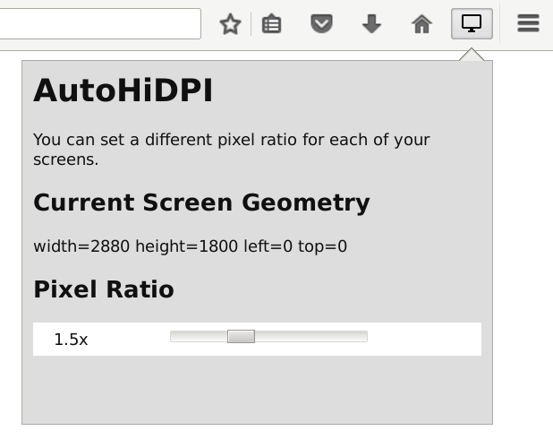

# AutoHiDPI

> [!WARNING]
> **Obsolete. This add-on no longer works and will not be updated.**

If you used two monitors with different pixel densities — say a sharp HiDPI (Retina) screen next to an older, lower-resolution one — Firefox would look correctly sized on one but too big or too small on the other. This add-on fixed that by automatically adjusting Firefox's scaling to match whichever screen its window was on, so it always looked right. (Under the hood, it set Firefox's `layout.css.devPixelsPerPx` value per screen.)

At its peak in 2016 it had around 1,500 average daily users, with [27 user reviews and a rating of roughly 4.4](https://web.archive.org/web/20181102030736/https://addons.mozilla.org/en-US/firefox/addon/autohidpi/), before it was removed from addons.mozilla.org in 2018.

It stopped working in Firefox 57 (2017). It was built on Mozilla's Add-on SDK ("jetpack"), which Firefox removed when it switched to WebExtensions.

- **A WebExtensions port isn't possible.** The add-on worked by setting the privileged `layout.css.devPixelsPerPx` preference per monitor. Mozilla declined to expose this to WebExtensions ([bug 1373607](https://bugzilla.mozilla.org/show_bug.cgi?id=1373607), WONTFIX), so the core mechanism can't be rebuilt as a modern extension.
- **Firefox now handles mixed-DPI multi-monitor setups without it on most platforms.** On **Windows**, per-monitor DPI is native and the window rescales across monitors automatically ([bug 890156](https://bugzilla.mozilla.org/show_bug.cgi?id=890156), fixed in Firefox 47). On **Linux/Wayland**, per-monitor scaling is delegated to the compositor — the approach Mozilla now recommends.
- **Linux/X11** still lacks per-monitor scaling ([bug 1228570](https://bugzilla.mozilla.org/show_bug.cgi?id=1228570); [bug 1679335](https://bugzilla.mozilla.org/show_bug.cgi?id=1679335) was closed WONTFIX with the guidance to use the Wayland backend). This is an X11 limitation that an extension can't fix. Switching to a Wayland session resolves it.

Thanks to everyone who used and contributed to this project!
